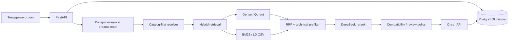

<div align="center">

# RAG Tender

**Поиск технически подходящих позиций каталога LD по строкам промышленных тендеров**

*Industrial tender nomenclature matching · Catalog-first + Hybrid RAG*


[](https://github.com/ObiVanBanan/rag_trend/actions/workflows/production-api.yml)

[Демонстрация](docs/DEMO_RU.md) · [Быстрый запуск](docs/GETTING_STARTED_RU.md) · [Архитектура](docs/ARCHITECTURE_RU.md) · [API](docs/API_RU.md) · [Качество](docs/QUALITY_RU.md) · [Roadmap](docs/ROADMAP_RU.md)

</div>

---

## Задача

В промышленном тендере товар часто описан свободным текстом: сокращения, ГОСТ, Ду/Ру, торговые обозначения, артикулы других производителей. Обычный семантический поиск может предложить похожий по названию, но **технически несовместимый** товар.

**RAG Tender** принимает список таких строк и формирует предложения из каталога LD. В основе — разбор технических параметров, распознавание обозначений конкурентов, гибридный поиск и проверка ограничений. Для инженерной проверки предусмотрен отдельный маршрут с кандидатами и объясняющими атрибутами.

> **Статус: Technical Preview.** Это рабочая кодовая база API и исследовательский прототип для подбора *с обязательной проверкой специалистом*, а не сертифицированный автоматический подбор промышленной арматуры. Не использовать ответ как разрешение на монтаж или закупку без инженерной верификации.

## Возможности текущей ветки

| Возможность | Реализация |
|---|---|
| Пакетный подбор | `POST /v1/match`, вход — массив строк `products` |
| Бизнес-демо | `/demo`: top-10 кандидатов LD, изменение характеристик, выбор/отклонение, полные слепки запросов и ответов в браузере |
| Статистика демо | `/demo/stats`: четыре графика по реальным событиям PostgreSQL, отдельный доступ администратора |
| Инженерный shortlist | `POST /v1/shortlist`: список кандидатов, характеристики, признаки блокировки и необходимость ручной проверки |
| Распознавание технических параметров | DN/PN, материалы, присоединение, управление, проход, среда и идентичность модели — в пределах поддерживаемых правил |
| Конкурентные обозначения | Каталог-ориентированный resolver и provenance-aware база знаний для MARSHAL / ALSO / TEMPER |
| Поиск | Dense embeddings (OpenAI) + BM25 + Reciprocal Rank Fusion + технический prefilter |
| Выбор кандидата | DeepSeek-интерпретация запроса и reranking; second-chance retrieval при необходимости |
| Надёжность API | Bearer token, лимит размера пакета, process-local admission/quota, health checks |
| Аудит запросов | PostgreSQL хранит снимки полных запросов и ответов; `X-Request-ID` для корреляции |
| Наблюдаемость | `/metrics` (Prometheus), структурированные stage traces для внешнего Grafana/Loki |

**В этой ветке есть бизнес-демо** с top-10, ручной коррекцией и событиями проверки. **Не интегрировано:** экспериментальное CSV-first → RAG сопоставление из отдельного PR. LD CSV для BM25 — не то же самое, что файлы CSV-маппингов.

## Как устроено решение



Подробнее: [архитектурные слои, зависимости и sequence diagram](docs/ARCHITECTURE_RU.md).

## Демо

Для быстрого знакомства без доступа к инфраструктуре: [пошаговый сценарий демонстрации, вопросы и ограничения](docs/DEMO_RU.md). Для live-демо требуются LD CSV, материализованный Qdrant snapshot и собственные OpenAI/DeepSeek ключи; без них готовый результат на API обещать нельзя. Для показа откройте `http://127.0.0.1:8002/demo`, для статистики — `/demo/stats`. Настройте отдельные `PUBLIC_DEMO_PASSWORD` и `PUBLIC_DEMO_ADMIN_PASSWORD`. В браузере применяется HTTP Basic (публичный доступ только через HTTPS); `/v1/match` и `/v1/shortlist` по-прежнему требуют Bearer token. CSV-first fallback сюда не перенесён.

## Быстрый старт

**Нужно:** Docker + Compose, Git LFS, Python 3.11+ (для локальной разработки), доступные OpenAI и DeepSeek API, оригинальный LD CSV с требуемой схемой. CSV **не входит в Git**. Подготовьте его до запуска в корне как `ld_products_full_nomenclature.csv`; Qdrant snapshot поставляется через Git LFS. Для демонстрации **без данных и API-ключей** подойдут только offline unit-тесты — API не запустится.

```bash
git clone https://github.com/ObiVanBanan/rag_trend.git
cd rag_trend
git lfs install
git lfs pull
cp .env.example .env
# Заполните .env: OPENAI_API_KEY, DEEPSEEK_API_KEY,
# POSTGRES_PASSWORD, API_DATABASE_PASSWORD, API_AUTH_TOKEN,
# PUBLIC_DEMO_PASSWORD, PUBLIC_DEMO_ADMIN_PASSWORD.
# Разместите ld_products_full_nomenclature.csv в корне.
docker network create rag-observability-net
docker compose up -d --build
curl http://127.0.0.1:8002/health/ready
```

Команда `docker network create` выполняется один раз; если сеть уже существует, используйте её. Никаких реальных токенов или паролей в репозитории быть не должно. Для каждого из трёх локальных секретов используйте **разные** случайные значения; token не короче 32 символов. `.env` не коммитить.

Пошаговая установка для Windows/PowerShell и Linux/macOS, диагностика и безопасное развёртывание: **[GETTING_STARTED_RU.md](docs/GETTING_STARTED_RU.md)**. Полное описание production: [PRODUCTION.md](PRODUCTION.md).

## Пример API

**Запрос** (с установленной переменной `API_AUTH_TOKEN`):

```bash
curl -X POST http://127.0.0.1:8002/v1/match \
  -H "Authorization: Bearer $API_AUTH_TOKEN" \
  -H "Content-Type: application/json" \
  -d '{"products":["Кран шаровой стальной Ду50 Ру16 для воды"]}'
```

**Структура ответа (иллюстрация, не результат реального прогона):**

```json
{
  "request_id": "generated-id",
  "results": [
    {
      "input": "Кран шаровой стальной Ду50 Ру16 для воды",
      "status": "NOT_FOUND",
      "matched_name": null,
      "matched_article": null,
      "score": null,
      "confidence": null,
      "error_code": null
    }
  ],
  "latency_ms": 0.0
}
```

В реальном ответе `status` может быть `MATCHED`, `NOT_FOUND` или `ERROR`. `matched_name` и `matched_article` заполняются только при подборе. `confidence` — оценка reranker, **не** подтверждённая вероятность инженерной совместимости. Для ревью используйте `/v1/shortlist`, а не автоматически принимайте `/v1/match`.

Полный контракт: [docs/API_RU.md](docs/API_RU.md) · интерактивная OpenAPI: `http://127.0.0.1:8002/docs` после запуска.

## Качество и ограничения

Контрольный **DEV frozen-100, seed 53** на конфигурации от **20 октября 2026 г.**: **34/100 top-1 hit-any**, **92/100 acceptable в широком pool**, **83/100 в top-20 reranker**. Постфактум после корректировки эталонных меток — **39/100**, *без нового прогона модели*. Это показатели попаданий относительно GOLD, не сертификат безопасности и **не** финальный holdout/production SLA. Подробнее о методике и оговорках: [QUALITY_RU.md](docs/QUALITY_RU.md) и [эксперименты](docs/EXPERIMENTS.md).

Критичные параметры — рабочая среда (газ/жидкость), DN, PN, присоединение, материалы, тип прохода, привод и исполнение. Неизвестные факты требуют дополнительного подтверждения. Строительная длина и виды газа намеренно не входили в отдельную метрику ревизии GOLD; это **не** освобождает от инженерной проверки.

## Структура проекта

```text
src/nomenclature_matcher/
  api.py                # FastAPI, API Bearer + demo Basic auth
  business_demo.py      # бизнес-маршруты, top-10 и коррекции
  business_demo*.html   # автономные страницы UI и статистики
  demo_feedback.py      # audit trail решений в PostgreSQL
  application/          # use cases, selection, reranking, history
  domain/               # products, constraints, medium, identity
  infrastructure/       # Postgres, catalog KB, adapters
  matcher.py            # facade к конвейеру подбора
  production.py         # composition root
data/competitor_catalogs/ # правила и источники по конкурентам
migrations/             # версия схемы истории
qdrant/                 # snapshot в Git LFS
scripts/                # batch, index, smoke и evaluation
tests/                  # контрактные и регрессионные тесты
docs/                   # руководство, архитектура, качество
```

## Разработка

```bash
uv sync --locked --extra test
uv run python -m pytest -q tests
```

Тесты не заменяют full-stack проверку с настоящими поставщиками API, Qdrant и PostgreSQL. Перед production rollout проверьте [release gates](docs/ROADMAP_RU.md) и [security policy](SECURITY.md).

## Документация

- [Сценарий демонстрации коллегам](docs/DEMO_RU.md)
- [История изменений](CHANGELOG.md) · [Чеклист релиза](RELEASE_CHECKLIST.md)
- [Установка и конфигурация](docs/GETTING_STARTED_RU.md)
- [Архитектура и обработка запроса](docs/ARCHITECTURE_RU.md)
- [Архив ранних ТЗ и заметок по рефакторингу](docs/archive/README.md)
- [API и примеры](docs/API_RU.md)
- [Бенчмарки и политика технической совместимости](docs/QUALITY_RU.md)
- [Roadmap / критерии релиза](docs/ROADMAP_RU.md)
- [Эксплуатация](PRODUCTION.md) · [Observability](OBSERVABILITY.md)
- [Вклад в проект](CONTRIBUTING.md) · [Уязвимости](SECURITY.md)

**Default Compose port:** `8002` (из `docker-compose.override.yml`; при изменении `API_PORT` используйте новое значение). Если запускать только `docker-compose.yml` через `-f`, default — `8000`.

**License:** лицензия пока не выбрана; наличие публичного исходного кода само по себе не предоставляет разрешения на использование или распространение.

