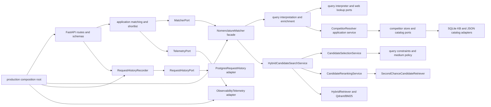
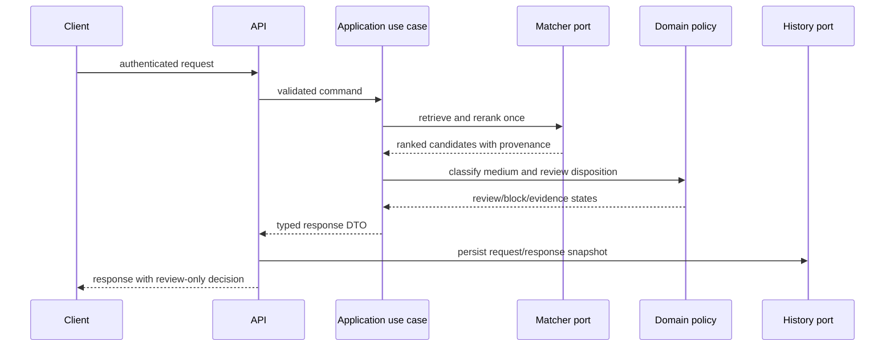

# Architecture map and refactoring target

## Current state after the application-service extraction

The `application` package owns batch-match and shortlist use cases, candidate selection, reranking, second-chance retrieval, hybrid candidate search, query preparation, and competitor-resolution orchestration. The resolver depends on store/catalog ports; SQLite persistence and JSON catalog loading live in `infrastructure`. `domain.product` owns the LD catalog product entity; `domain.constraints` owns validated query facts and product compatibility policies; `domain.medium` owns phase classification; `domain.competitor` owns exact identity and sourced facts; `domain.query_signals` owns technical and identity signal parsing. These core modules no longer depend on the legacy DTO module. Query constraint extraction no longer imports an LLM client; the optional DeepSeek adapter is in `infrastructure`. PostgreSQL request history and runtime client construction are also infrastructure/composition concerns. `NomenclatureMatcher` is now a thin public facade with compatibility methods; its candidate pipeline delegates to these services.

`QueryPreparationService` coordinates the interpreter, competitor resolver, optional web lookup, identity gate, query-policy helpers, and retrieval-plan construction. Its interpreter, lookup, resolver, and telemetry dependencies are ports; it returns a typed `PreparedQuery` or an early `MatchResult`. HTTP handlers own transport validation, request timing, and response DTO mapping. Completed request snapshots are converted to an application record and persisted by `RequestHistoryRecorder` through `RequestHistoryPort`; persistence failures are measured and logged without changing the matching response.

## Remaining architecture risks

- `QueryPreparationService` still coordinates several policies, but its interpreter, lookup, resolver, and telemetry dependencies use ports and typed results. It may be split further once behavior boundaries are stable.
- The application package no longer imports concrete infrastructure adapters or global observability functions. The HTTP module still owns transport-level request timing, middleware logging/metrics, and response mapping.
- API handlers construct the request-history record and invoke the application recorder. Mapping this transport data into a use-case command/response remains a possible further extraction, but persistence itself is behind application and infrastructure ports.
- `ProductionRuntime` still exposes a concrete settings object; matcher, history, collection readiness, and lifecycle use application Protocols. `ExitStack` closes HTTP, Qdrant, web-search, and database resources in reverse creation order.
- Request-history DDL is versioned and applied by a Compose one-shot job; it was smoke-tested against an isolated blank database and a legacy schema, but not against the user's active production database.
- Auth is bearer-token based with no user/role model, rotation endpoint, or rate limits. Production Compose is loopback-bound by default; remote use requires TLS termination.
- Medium classification covers the requested gas/liquid comparison, but full catalog vocabulary and certification provenance have not been audited.
- Full-stack acceptance with the project's real provider credentials, Qdrant snapshot, and deployment settings remains outstanding; the current verification covers unit/API tests (199 passing), isolated PostgreSQL, and the container image smoke path.
- The root `.env` currently lacks `POSTGRES_PASSWORD`, `API_AUTH_TOKEN`, `OPENAI_API_KEY`, and `DEEPSEEK_API_KEY`. The isolated full-stack smoke configuration therefore cannot render; no placeholder credentials were passed to the application.

## Refactoring target

1. Keep HTTP schemas/routes in `api` and move each endpoint's orchestration into an application service.
2. Define small ports for matching, request history, retrieval, query interpretation, reranking, and lifecycle management.
3. Keep `domain` dependency-free: product facts, compatibility policy, decisions, and explicit unknown states.
4. Keep external clients, CSV/Qdrant/Postgres adapters, and web search in `infrastructure`.
5. Make `production.py` a composition root only; construct services from settings and concrete adapters there.
6. Keep the matcher facade as a compatibility boundary; move any remaining endpoint orchestration and concrete adapter assumptions behind application ports.
7. Move schema creation to versioned migrations before multiple replicas or automated production rollout.

## Request flow target

## Production security baseline introduced

- Production startup requires `API_AUTH_TOKEN` with at least 32 characters.
- Health and OpenAPI/docs paths are public; all operational routes, including metrics, require bearer authentication. OpenAPI declares the protected operations.
- Compose refuses empty API token and database password variables.
- Default API host binding is `127.0.0.1`; remote ingress must provide TLS.
- Compose uses project-scoped container names and service DNS for backend traffic. Stable network aliases preserve the monitoring endpoints without globally reserved container names.
- PostgreSQL migrations run with the admin account; the API receives a separate non-superuser role with only schema-version read and request-history insert privileges. Each migration run also removes prior role memberships and object grants before applying the allowlist. Compose clears admin and role-provisioning passwords from the API container environment. An isolated PostgreSQL smoke verified adapter open/ping/insert/close, persisted insertion, removal of existing elevated grants, and denied DDL.
- The token is a shared bearer secret; rotate it through deployment secrets management.
- Candidate ranking and competitor-resolution stages now have separate application services. Matcher collaborators, query preparation, and telemetry use explicit ports and concrete model types; provider construction is in the composition root, and match inputs are capped at 4,000 characters. The domain package owns `LDProduct`, query signals, competitor facts, and compatibility policies; architecture tests prevent domain/application dependency inversions. The current full behavior suite passes (199 tests; one upstream Starlette deprecation warning).
- The production image uses `uv.lock` with `uv sync --locked`, runs as UID 10001, and includes the locked DuckDuckGo MCP command so runtime startup does not resolve that server package dynamically.
- The API container has a read-only root, bounded temporary filesystem, no Linux capabilities, and no privilege escalation; its knowledge DB is on a dedicated writable volume. A network-isolated one-shot init container grants that volume to UID 10001 with only `CAP_CHOWN`. Docker caches third-party dependencies separately from source rebuilds.
- `ProductionRuntime` depends on application Protocols for matcher, request history, Qdrant collection readiness, and resource scope; concrete construction and `ExitStack` registration remain in the composition root.
