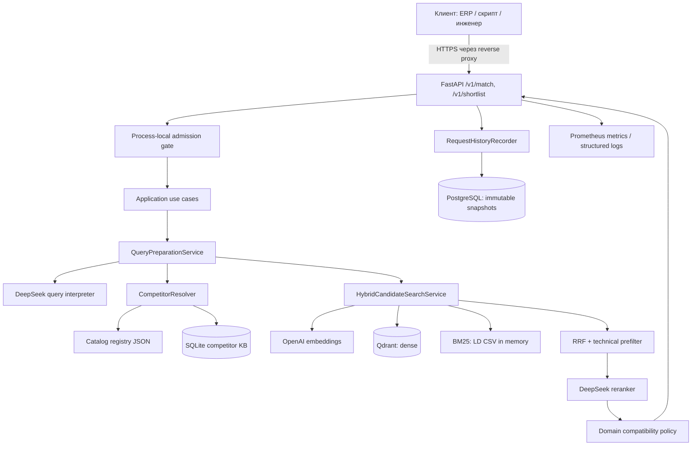
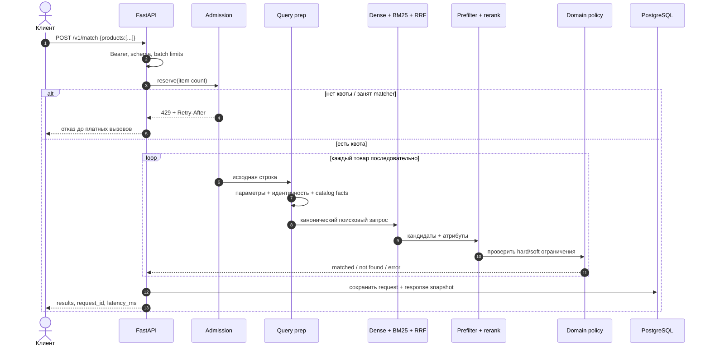
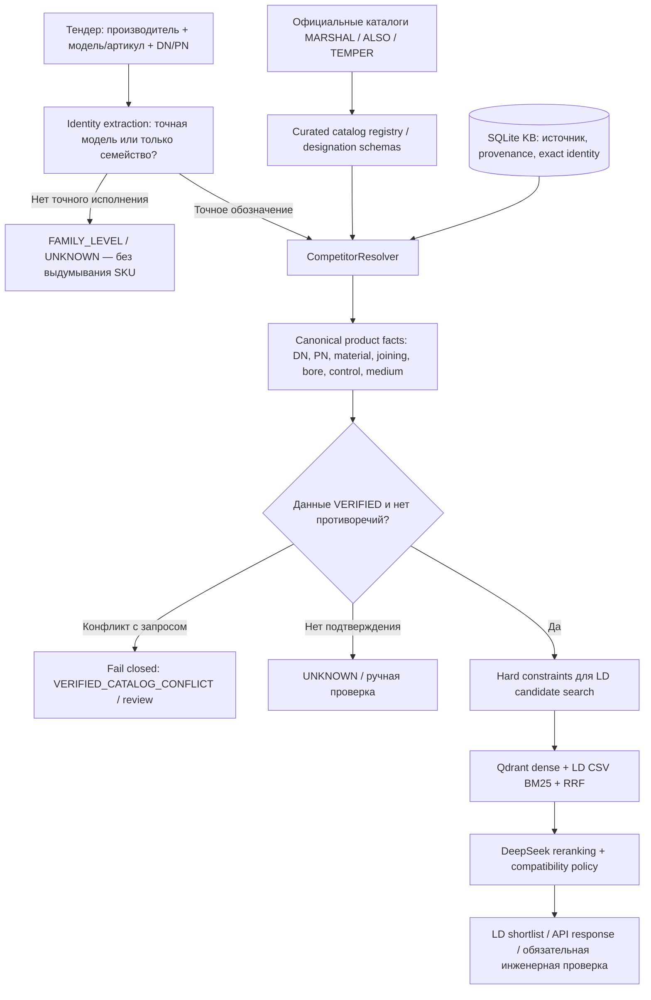

# Архитектура RAG Tender

[← README](../README.md) · [API](API_RU.md) · [Design notes](../design/architecture.md)

## Системный контекст

Граница системы — API. Мониторинг Grafana/Prometheus/Loki работает **внешним стеком** через общую Docker network, а не создаётся основным Compose. В коде остаётся опциональный web lookup (MCP), но рекомендуемая оценённая конфигурация имеет `WEB_SEARCH_ENABLED=false`.

## Обработка запроса

`/v1/shortlist` использует тот же matcher, но возвращает кандидатов для ревью, в том числе `blocked_candidates` при явной несовместимости рабочей среды. Это не approval workflow и не технический сертификат.

## Логические слои

| Слой | Папка / ключевые файлы | Ответственность |
|---|---|---|
| HTTP / transport | `src/nomenclature_matcher/api.py` | Входные модели, bearer auth, коды HTTP, health, metrics |
| Application | `application/{matching,query_preparation,hybrid_candidate_search,candidate_selection,candidate_reranking,shortlist,...}.py` | Сценарии, управление конвейером, history recorder, admission |
| Domain | `domain/{product,constraints,medium,competitor,query_signals}.py` | Товарные факты, технические ограничения, UNKNOWN, проверка среды |
| Infrastructure | `infrastructure/{postgres_history,competitor_knowledge_store,competitor_catalog_registry,...}.py` | Доступ к хранилищам и внешним источникам |
| Composition | `production.py` | Внедрение зависимостей, жизненный цикл ресурсов |
| Adapters | `embeddings.py`, `qdrant_store.py`, `bm25_store.py`, `reranker.py` | Сторонние API и поиск |
| Runtime | `docker-compose.yml`, `Dockerfile`, `migrations/` | Контейнеры, SQL миграции, права, готовность |

## Почему такой конвейер

1. **Catalog-first / identity guard.** Обозначение производителя и конкретное исполнение рассматриваются как источник возможных ограничений. Нельзя подменять неизвестный вариант «похожим семейством» без evidence.
2. **Hybrid retrieval.** Dense покрывает смысловые вариации; BM25 сохраняет лексические совпадения по обозначениям и параметрам. Списки объединяются через RRF.
3. **Technical prefilter.** Жёсткие известные ограничения и мягкие признаки учитываются до окончательного top-20, снижая риск потери подходящего кандидата на раннем отсечении.
4. **Rerank + review.** LLM помогает расставлять кандидатов, но не объявляет их сертифицированными. Пустые или конфликтующие факты требуют ручной проверки.
5. **Auditability.** JSON snapshot запроса и ответа сохраняется с отдельным уникальным `history_id`. Клиентский `X-Request-ID` — корреляционный ID и может повторяться.

## Границы и незакрытые риски

- Текущая реализация создаёт BM25 по LD CSV в памяти. Масштабирование Uvicorn workers дублирует объём; лимит запросов/час — process-local, не распределённый.
- Если SQL history недоступна, readiness не пройдёт; проблемы persistence логируются, но ответ matching может быть сформирован отдельно.
- Не реализованы гарантированный денежный budget провайдеров, многоарендность и RBAC.
- Для реального production необходимы TLS, проверенный backup/restore, secret scanning, отдельные provider spend caps и end-to-end проверка на целевом окружении.
- Режимы UI и CSV-first живут в других ветках; они **не входят** в этот deployable runtime.

Подробный рефакторинг и портовая архитектура — в [design/architecture.md](../design/architecture.md). Логи/метрики — в [OBSERVABILITY.md](../OBSERVABILITY.md).

## Откуда берутся характеристики конкурентов

**Приоритет источников:** подтверждённый каталог точного исполнения и явно заданные требования тендера важнее предположений LLM. Если они конфликтуют, система не должна выбирать «похожий» продукт. Шаблон обозначения может декодировать атрибуты модели, но само наличие синтаксически корректного артикула **не подтверждает существование SKU** и допуски для газа. Каталожные исходники и ограничения по производителям — [data/competitor_catalogs/README.md](../data/competitor_catalogs/README.md).

**Важное различие:** производственные каталоги конкурентов нужны для *понимания исходного товара*. Отдельный LD CSV и индекс Qdrant нужны для *поиска аналога в целевом каталоге*. Никакие GOLD-метки не должны попадать в runtime resolver.
